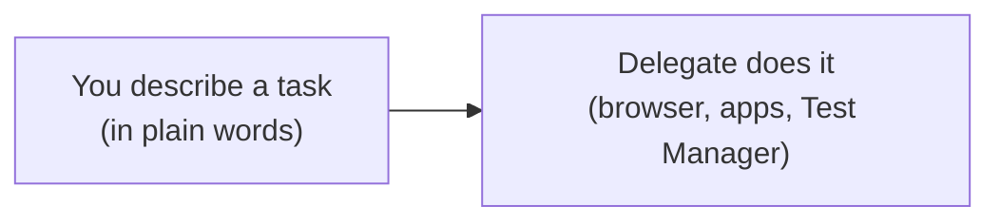

# Prerequisites

Do this checklist **at least a few days before the workshop**. It takes about 30 minutes. Most of the day runs in your browser; the only thing you install is **UiPath Assistant with Delegate**, plus a one-time connection to Test Manager.

When you're done, send your trainer a screenshot of Delegate showing your tenant (see [Ready?](#ready)).

!!! note "Labels may differ"
    This workshop runs on a tenant with the latest features. Your screens may show slightly different labels. Features marked **(Preview)** may still change.

## Your machine

<div class="req-list" markdown>

--8<-- "system-requirements.md"

</div>

On the day, Delegate works on your screen while you watch, so your laptop must stay awake and unlocked. Turn screen lock back on after the workshop.

??? tip "How to keep the screen on (Windows 11)"
    1. Open **Start → Settings → System → Power & battery → Screen, sleep, & hibernate timeouts**.
    2. Under **Plugged in**, set **Turn my screen off after** and **Make my device sleep after** to **Never**.

    On a company laptop, a policy may still lock the screen. Check with your IT team.

??? tip "How to keep the screen on (macOS)"
    Open **System Settings → Lock Screen** and set **Turn display off on power adapter when inactive** to **Never**.

    On a company Mac, a policy may still lock the screen. Check with your IT team.

## Accounts and access

Your trainer invites you to the workshop **organization** and **tenant**, and sends you the sign-in link. It looks like `https://<host>/<ORG>/<TENANT>`. For most organizations, the host is `cloud.uipath.com`.

1. Open the link and sign in with the account your trainer invited.
2. Open **Test Manager** from the left menu. You see the list of Test Manager projects. It may be empty: you create your own project in step 1 of the workshop.
3. Allow pop-ups for this site in your browser. Test Manager opens the manual test window as a pop-up.

!!! info "Check your licence"
    The **Autopilot** icon (a sparkle, top right) appears only **inside** a project, not on the project list. If a project is already listed, open it and look for the icon. If no project is listed yet, you'll check it in step 1.

    No Autopilot icon inside a project? Ask your trainer to check your **user licence**: you need **App Test Developer** or **App Tester**.

Your trainer has prepared the shared workshop folder and the robots. You don't set up anything in Orchestrator.

## Install UiPath Assistant and Delegate

**UiPath Delegate** is a desktop AI agent. You give it a task in plain words, and it does the work on your machine, in your browser and apps, while you watch. It comes with **UiPath Assistant**.



For testing, Delegate works with **Test Manager**: in the workshop it runs a test case on the UiBank website and records the result, and later it reproduces a defect and writes a report.

=== "Windows"

    1. Download the installer: <a href="https://download.uipath.com/connected-installer/latest/sts/UiPathPlatformSTS.msi" target="_blank">UiPathPlatformSTS.msi</a>.
    2. Run it, and select only **Assistant, Delegate & Cartographer**. **Robot** and **Extensions** are selected for you. Accept the licence and select **Install**.
    3. Open UiPath Assistant once it's installed.

    !!! tip "Used Delegate during Preview?"
        Uninstall the Preview build first, then install the current installer. In Delegate, open **Settings → General → About** and check that the version starts with `v26`. See <a href="https://docs.uipath.com/delegate/standalone/latest/user-guide/moving-from-preview-to-ga-installer" target="_blank">Moving from the Preview installer to the GA installer</a>.

=== "macOS"

    !!! info "Delegate for macOS (Preview)"
        Delegate for macOS is in Public Preview. It works for the workshop, but screens may change. If it doesn't work on your Mac, every step has a browser path, and you can pair with a neighbour for the Delegate parts.

    You need a Mac with Apple silicon (M1 or later), macOS 14 Sonoma or later, and 8 GB of free disk space. Intel Macs aren't supported.

    1. Install Delegate for macOS as your trainer tells you:
        - **Enterprise organizations:** the DMG (`UiPath Assistant (arm64).dmg`). Open it and drag the app to **Applications**. It doesn't update itself.
        - **Community organizations:** the UiPath Platform Installer for macOS (PKG).
    2. Open UiPath Assistant from **Applications**.

    See <a href="https://docs.uipath.com/delegate/standalone/latest/user-guide/installation" target="_blank">Install and update</a>.

## Set up Delegate

1. In **UiPath Assistant**, click the person icon or your initials (top right) → **Preferences** → **Orchestrator connection**. Sign in with your workshop account and select the workshop tenant.

    If your trainer gave you a host other than `cloud.uipath.com`, enter it as the service URL before you sign in. Your trainer tells you what to type.

    ??? tip "Assistant already shows you signed in, but to another tenant?"
        1. Click **Sign out**. Your default browser opens and asks if you want to log out. Don't click it.
        2. In that browser, sign in to the workshop tenant.
        3. Go back to Assistant, click **Sign in**, and select the workshop tenant.

2. Select **Delegate** in Assistant's top ribbon. It appears only once Assistant is connected.
3. Set the work profile: click your user name (bottom left) → **Settings** → **Behavior preferences**, and select **QA / Testing**.

    Optional: in the same **Behavior preferences**, pick a plain-language **Tone** and a shorter **Depth**.

4. Click **+ New** in the left panel to start a session. Use this one session for the whole workshop.
5. Pick a model in the model selector next to the chatbox. We suggest **Claude Opus**. Other models work too, but their answers may differ from the guide's samples.

    

6. Choose how much Delegate does on its own: select **Adaptive** in the mode selector next to the chatbox (or **Settings → Security**) and turn **Smart approvals** on.

    | Approval mode | What Delegate does |
    |---|---|
    | **Cautious** | Asks before every action. A good choice for regulated teams |
    | **Adaptive** *(recommended)* | Does safe, read-only actions on its own, and asks before anything that changes data. **Smart approvals** also approves what Delegate judges safe |
    | **Full access** | Never asks – trusted environments only |

!!! warning "Delegate acts on your behalf"
    It uses your UiPath account and permissions, and every action is logged in your name.

    ✅ Keep screen context on **Default** (the screen icon next to the chatbox), so Delegate sees only the apps you attach to the chat.

    ✅ In **Settings → Security → Blocked websites**, quick-add **Banking**, **Payments** and **Password Manager**.

✅ Check that the UiPath browser extension is turned on in the browser you'll use: open `chrome://extensions` (Chrome) or `edge://extensions` (Edge). If you have several Chrome profiles, use one profile for the whole workshop. Not listed? The extension comes with the UiPath Assistant installer – ask your trainer to help you add it.

## Connect Delegate to Test Manager (one time, ~5 min) { #connect-delegate-to-test-manager }

Delegate talks to Test Manager through a small UiPath command-line tool (CLI – Command Line Interface). You install it once and sign it in once. You copy two lines; you don't need to learn any commands.

Your trainer sends you the **host**, **organization** and **tenant** to use. Keep that message open.

**1. Install the tool.** Copy the line for your computer, paste it, and press **Enter**.

=== "Windows"

    Open **PowerShell** (press the Windows key, type `PowerShell`, and press **Enter**). A normal window is fine. Paste:

    ```powershell
    $env:UIP_SKIP_SKILLS="1"; $env:UIP_SKIP_RUNTIMES="1"; irm https://download.uipath.com/uipath-cli/install.ps1 | iex
    ```

    If **Node.js** isn't on your laptop, the script installs it first. Windows may ask **Do you want to allow this app to make changes to your device?** Select **Yes**.

=== "macOS"

    Open **Terminal** (press **Cmd + Space**, type `Terminal`, and press **Enter**). Paste:

    ```bash
    curl -fsSL https://download.uipath.com/uipath-cli/install.sh | bash -s -- --skip-skills --skip-runtimes
    ```

    If **Node.js** isn't on your Mac, the script installs it first, without asking for your Mac password.

Wait until the script finishes and you see the prompt again. It takes a few minutes. The extra settings in the line skip parts that only developers need.

**2. Sign in.** Close the window and open a **new** PowerShell or Terminal window, so it finds the new tool. Paste this line, with the three values from your trainer in place of `<host>`, `<ORG>` and `<TENANT>`:

```text
uip login --authority https://<host> --organization <ORG> --tenant <TENANT>
```

Your browser opens a UiPath sign-in page. Sign in with your workshop account. When the page says you're signed in, close the tab and go back to the window.

**3. Check it worked.** In the same window, paste:

```text
uip login status
```

It shows that you're logged in, with the workshop **organization** and **tenant**. Then close the window, and quit and reopen UiPath Assistant, so Delegate finds the tool.

!!! warning "If it fails"
    Don't spend more than 10 minutes on it. Send your trainer a screenshot of the error, and **bring your laptop 30 minutes early** on the day: the trainer helps you there. Common causes are a company laptop that blocks installs, or a proxy that blocks downloads. Ask your IT team if you can.

    You can still do the whole workshop: **every step has a browser path**, and for the Delegate parts you can pair with a neighbour.

!!! info "Signed out later?"
    The sign-in expires after a while without use. If Delegate later says it isn't signed in, or shows `401 Unauthorized`, run the sign-in line from step 2 again (30 seconds).

See <a href="https://docs.uipath.com/delegate/standalone/latest/user-guide/installing-delegate-for-the-testing-profile" target="_blank">Installing Delegate for the testing profile</a> and <a href="https://docs.uipath.com/delegate/standalone/latest/user-guide/testing-setup-faq" target="_blank">Testing setup FAQ</a>.

## Check Delegate { #check-delegate }

1. In your Delegate session, ask:

    ```text
    List the tenant I am connected to.
    ```

    Delegate replies with your organization, tenant and user name. Wrong tenant? Switch it as in the *Assistant already shows you signed in* tip, and ask again.

2. Then ask:

    ```text
    Check that you can reach Test Manager in my tenant, and list the Test Manager projects I can see.
    ```

    Delegate lists the projects, or says the list is empty. Both are fine: it reached Test Manager. If it says it isn't signed in, repeat [Connect Delegate to Test Manager](#connect-delegate-to-test-manager).

!!! tip "Delegate asks to approve a command?"
    Delegate reaches Test Manager by running commands, in PowerShell on Windows or in the shell on a Mac. In **Adaptive** mode it asks first. You can approve each one, or select **Allow Run PowerShell for this session**. That lets Delegate run **any** PowerShell command without asking until the session ends, so choose it only on your workshop laptop.

??? info "No Delegate on the day?"
    Locked-down laptop, Mac problems, or the connection failed? You can still do every step. Steps that use Delegate also have a **browser path**, and you can pair with a neighbour to watch Delegate work.

## Ready? { #ready }

!!! success "Check it"
    ✅ You can sign in to the workshop tenant and open **Test Manager**.

    ✅ Pop-ups are allowed for the site.

    ✅ UiPath Assistant is installed, signed in to the workshop tenant, and shows **Delegate** in the top ribbon.

    ✅ Delegate uses the **QA / Testing** profile, with **Adaptive** mode and **Smart approvals** on.

    ✅ The sign-in check in [Connect Delegate to Test Manager](#connect-delegate-to-test-manager) showed the workshop organization and tenant.

    ✅ Delegate answered both check prompts.

    ✅ The UiPath extension is turned on in the browser profile you'll use.

    Send your trainer a screenshot of Delegate's answer to *List the tenant I am connected to.*

---

[Next → Introduction](../module-1-introduction/index.md){: .md-button .md-button--primary}
