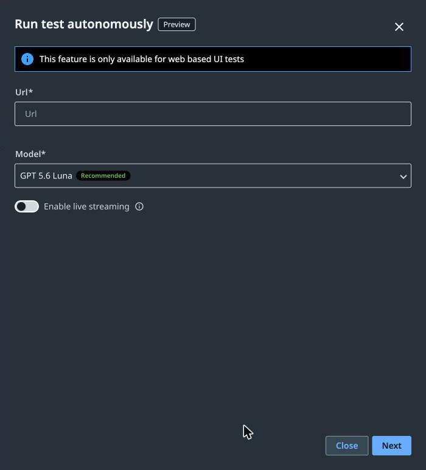
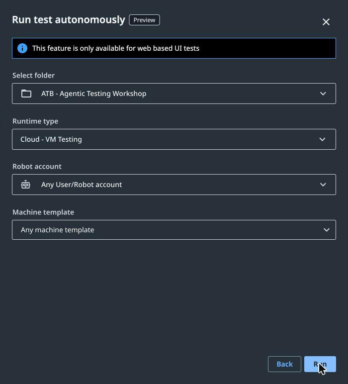

# 4. Run the Test Three Ways

<p class="step-meta">Leads: <span class="persona-badge persona-badge--uat">UAT</span> · Tools: <span class="tool-badge tool-badge--testmanager">Test Manager</span> <span class="tool-badge tool-badge--robot">Robot</span> <span class="tool-badge tool-badge--delegate">Delegate</span></p>

<div class="flow">
  <a class="flow-step" href="#1-start-the-robot-first-preview">Start the robot first</a>
  <span class="flow-arrow"></span>
  <a class="flow-step" href="#2-run-it-yourself">Run it yourself</a>
  <span class="flow-arrow"></span>
  <a class="flow-step" href="#3-hand-it-to-delegate">Hand it to Delegate</a>
  <span class="flow-arrow"></span>
  <a class="flow-step" href="#check-your-three-runs">Check your three runs</a>
</div>

**Why it matters for you:** UAT sign-off needs evidence. Here you see what a person, a desktop agent and a robot each record for the same test case, and whether all three catch the same UiBank defect.

You run **Submit Over-65 Request**, the test case you made in [3. Generate Test Cases](03-generate-test-cases.md#name-your-over-65-test-case), three times: on a robot, yourself, and with Delegate.

UiBank has a defect. An applicant aged 66 gets *Congrats! You've been approved…*, but the requirement says applicants over 65 must be rejected. So a correct run of this test case **fails**. That's the result you're looking for.

!!! warning "Start the robot first"
    The robot is shared by the whole class and runs one test at a time. Start your robot run before anything else on this page. Its result comes in after lunch.

## Three testers, one test case

| | Who does the steps | Where | Evidence it leaves | What it uses | Your time |
|---|---|---|---|---|---|
| **Run autonomously** (Preview) | Autopilot, on the trainer's shared robot | A cloud machine | A result for each step, screenshots, comments it writes itself, Autopilot's reasoning | App Test Platform Units, from the tenant | ~3 min to start |
| **You** (Execute Manually) | You | Your browser | Pass or fail for each step, your comments, your screenshots | Your time only | ~10 min |
| **Delegate** | Delegate, the desktop agent | Your browser, with your mouse and keyboard | A result for each step, a trace for each step, a final screenshot | Your AI usage allowance | ~10 min |

## 1 – Start the robot first (Preview)

**Run autonomously** (Autonomous Test Execution) gives one manual test case to Autopilot. Autopilot reads the steps and does them in a browser on a robot, with no automation built.

!!! info "Preview"
    Labels and behavior may change. Your tenant may show slightly different labels.

1. Go to **Test Cases**. On the **Submit Over-65 Request** row, select **⋮** → **Execute Autonomously**.

    You can also open the test case, go to the **Manual Steps** tab and select **Run Autonomously** in the right-hand panel:

    

2. The **Run test autonomously** (Preview) panel opens. Its banner says the feature is only for web-based UI tests. That's fine: UiBank is a web app.
3. On the first screen:

    ✅ **Url**: type `https://uibank.uipath.com/loans/apply`. It isn't filled in from the test case, and you can't go on without it.

    ✅ **Model**: keep the one marked **Recommended**.

    ✅ **Enable live streaming**: leave it off. Your trainer streams one run for the whole class.

    Select **Next**.

    

4. On the second screen:

    ✅ **Select folder**: leave it as it is. It shows your project's Default Folder from step 1, **ATB - Agentic Testing Workshop**.

    ✅ **Runtime type**: your trainer tells you which runtime to use. On the workshop tenant it's **Cloud - VM Testing**, usually already selected. Don't pick a Serverless runtime: the list shows them, but Run autonomously doesn't support them.

    ✅ **Robot account**: **Any User/Robot account**.

    ✅ **Machine template**: **Any machine template**.

    Select **Run**.

    

5. The panel shows its progress and ends with *Autonomous test execution job triggered.* You can close the panel now.

!!! note "Waiting is normal"
    The shared robot runs one test at a time, about 6 minutes each. The first run of the day can also wait several minutes while the cloud machine starts. With the whole class in the queue, your run may finish only after lunch. Leave it and carry on: you read its result in [5. Compare the Runs](05-compare-the-runs.md).

    Select **Run** only once. Every extra click adds another run to the shared queue. If the panel shows an error, tell your trainer.

Run autonomously uses App Test Platform Units from the tenant, not your personal AI allowance. See <a href="https://docs.uipath.com/test-manager/automation-cloud/latest/user-guide/running-autonomous-test-execution" target="_blank">Running Autonomous Test Execution</a>.

## 2 – Run it yourself

You run the steps in UiBank and record each result in the **manual execution assistant**, Test Manager's window for manual runs. This is the core UAT skill: a person checks the app and leaves evidence.

1. Go to **Test Cases**. On the **Submit Over-65 Request** row, select **⋮** → **Execute Manually** (Test Cloud only).

    This starts a run of this one test case, with no test set.

    !!! tip "No Execute Manually in the ⋮ menu, or the window misbehaves?"
        Create a test set with only **Submit Over-65 Request**, then on the set select **Execute** → **Manually**.

    <!-- IMG: Test Cases list with the ⋮ menu open on the over-65 row, showing Execute Manually and Execute Autonomously (no user initials in the header) -->

    !!! info "Allow pop-ups for Test Manager"
        The manual execution assistant opens in a new window. If nothing opens, allow pop-ups for Test Manager in your browser, then select **Execute Manually** again.

2. Open <a href="https://uibank.uipath.com" target="_blank">UiBank</a> in another window, next to the assistant.
3. If the test case has a precondition, the state the app must be in before the test, set up UiBank as it says.
4. Do each step in UiBank, then select **Set Passed** or **Set Failed** in the assistant. To pass several steps in a row, select **Set Passed Until Here**.
5. At the step that checks the decision, UiBank shows *Congrats! You've been approved…* for your 66-year-old applicant. Your test case expects a rejection. Select **Set Failed** and add a comment, for example:

    ```text
    UiBank approved a 66-year-old applicant. The requirement says applicants over 65 must be rejected.
    ```

6. Add evidence to the failed step: a screenshot of UiBank's approval page. The assistant's step menu (**More options**) offers ways to capture the screen or upload an attachment.

    !!! tip "No capture option?"
        If you don't see a way to capture the screen, take a screenshot with your computer's own tool and upload it as an attachment. If you can't attach a file either, describe what you saw in the comment. If capturing switches you to another tab, switch back to the assistant yourself.

    <!-- IMG: manual execution assistant with the decision step set to Failed, the tester comment and the screenshot attached (phase 5: confirm the Capture screen / Upload attachment labels) -->

7. Finish the test case and select **Done**.

!!! info "Made a mistake?"
    A run started without a test set can't be run again. Start a new **Execute Manually** instead. See <a href="https://docs.uipath.com/test-manager/automation-cloud/latest/user-guide/executing-test-cases-without-a-test-set" target="_blank">Executing test cases without a test set</a>.

## 3 – Hand it to Delegate

**Delegate**, the desktop agent, runs the same steps in your browser with your mouse and keyboard. It then records the result in Test Manager. You watch, answer its questions and approve what it saves.

Use the **QA / Testing** session you set up in [Prerequisites](../module-0-prerequisites/index.md#set-up-delegate). Delegate is generally available on Windows. On a Mac, Delegate for macOS (Preview) runs the same prompts.

??? tip "No Delegate?"
    Skip this part and pair with a neighbour: watch their Delegate run. Your robot run and your own run are enough for [5. Compare the Runs](05-compare-the-runs.md).

!!! example "It's your turn now!"
    1. Keep only one UiBank tab open. Delegate finds the window by its title, and the prompt names UiBank.
    2. Before your first prompt, attach only the browser window with UiBank to the chat (the screen icon next to the chat box). Delegate then sees nothing else on your screen.
    3. Find two values in Test Manager:

        ✅ `<PROJECT_PREFIX>`: your project's prefix, which you typed when you imported the project in step 1.

        ✅ `<TEST_CASE_KEY>`: the key of **Submit Over-65 Request**, in the **Key** column of **Test Cases**. A key is your prefix, a colon and a number.

    4. Replace both placeholders, then paste:

        ```text
        In Test Manager project <PROJECT_PREFIX>, run the manual test case <TEST_CASE_KEY> (Submit Over-65 Request). Open UiBank at https://uibank.uipath.com, follow the test case's manual steps in the browser, and check every expected result. Stop and ask me if a step is unclear. Take a screenshot of the final result page and save it to my Desktop. When you finish, push the results to Test Manager, give me the link to the execution, and explain the reason for any failed step.
        ```

        It takes about 10 minutes. Delegate uses your mouse and keyboard, so don't touch them until it reports back. Follow its progress in the task list. If your screen locks, unlock it, and Delegate carries on.

    5. If Delegate asks you something, answer in plain words, as you would a colleague. For example: *"The field is labelled Age. Type 66 there."*
    6. When Delegate asks for permission to push the results to Test Manager, approve it. Read every other request before you approve it, too.
    7. Read its explanation of the failure. Does it call it a **defect in UiBank** or a **problem with the test case**?

!!! warning "Delegate says it can't reach Test Manager?"
    Your one-time connection from Prerequisites has probably expired. Repeat the sign-in in [Connect Delegate to Test Manager](../module-0-prerequisites/index.md#connect-delegate-to-test-manager), then paste the prompt again.

??? tip "Delegate keeps retrying the failing step?"
    Tell it: *"Mark this step Failed with what you see on the screen, and carry on."* Still stuck? Run **Submit Standard Loan Request** with Delegate instead. It passes, but you still see how Delegate records a run.

!!! question "Think about it"
    Did Delegate stop to ask about a step, or do something you didn't expect? The same steps feed Run autonomously now, and the automation in [6. Automate with Studio Web](06-automate-with-studio-web.md). An unclear step costs time for every tester, person or agent.

    Note the step. Don't change it yet: your robot run is still waiting and uses the same steps. You fix it in [5. Compare the Runs](05-compare-the-runs.md).

??? info "Beyond running tests – Delegate across the whole manual testing cycle"
    Ideas to try on your own project, in your own words:

    ✅ **Find test ideas** – from a requirement's acceptance criteria, or from a screenshot of a screen, including boundary and negative cases.

    ✅ **Write the steps** – turn those ideas into manual test cases and link them to the requirement.

    ✅ **Run them with you** – Delegate runs the steps and stops to ask when it needs a decision from you. Never paste passwords into the chat.

    ✅ **Record the results** – create test results with screenshots of failed steps, and upload them to Test Manager.

    See <a href="https://docs.uipath.com/delegate/standalone/latest/user-guide/manual-test-execution-use-case" target="_blank">Manual test execution with Delegate</a>.

## Check your three runs

!!! success "Check it"
    Go to **Execution**:

    ✅ Your own run of **Submit Over-65 Request** shows **Failed**, with your comment and your screenshot (or description) on the decision step.

    ✅ The Delegate run shows **Failed**, with a result for each step and a Delegate trace attached to the steps. Delegate names it **Delegate-** followed by the test case name and the date. The final screenshot is on your Desktop.

    ✅ Your robot run is listed. It's fine if it hasn't finished yet. Can't find it? Ask your trainer, who can see the queue.

<!-- IMG: Execution list with the manual run and the Delegate run of Submit Over-65 Request, both Failed (no executor names visible) -->

## Nice work!

You ran the same test case as a tester, with Delegate, and on a robot. Both finished runs caught UiBank's over-65 defect. After lunch, you compare all three.

---

[Next → 5. Compare the Runs](05-compare-the-runs.md){: .md-button .md-button--primary}

---
