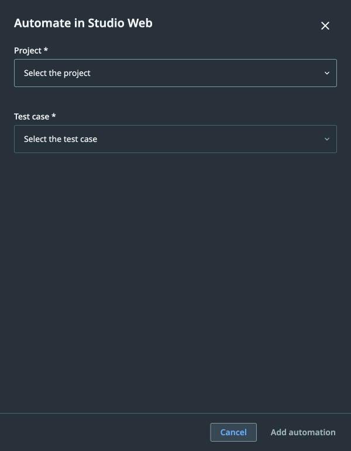

# 6. Automate with Studio Web

Leads: All QA · Tools: Trainer demo Studio Web Test Manager

  <a class="flow-step" href="#1-create-the-automated-test">Trainer: create the automated test</a>
  
  <a class="flow-step" href="#2-build-and-check-it">Trainer: build and check it</a>
  
  <a class="flow-step" href="#3-publish-it">Trainer: publish it</a>
  
  <a class="flow-step" href="#link-your-test-cases-to-the-automated-tests">You: link 3 test cases</a>
  
  <a class="flow-step" href="#check-the-package-name-column">You: check Package Name</a>

**Why it matters for you:** an automated test gives the same answer every time and costs no AI to repeat. It is how your manual checks become a regression set that runs every night, without anyone clicking through UiBank.

Your trainer turns a manual test case into an automated test in Studio Web and publishes it. Then you link three of your test cases to the trainer's automated tests, so a robot can run them in step 7.

## Watch: from test case to automated test

Trainer demo Studio Web

You watch this part, about 15 minutes. You don't need to build automations yourself: in most teams, an automation colleague does it. What matters is that you know what happens to your test case, and what the robot checks.

**Studio Web** is UiPath's browser-based design tool. A **Tests project** in Studio Web holds automated tests, each linked to a test case in Test Manager. Your trainer built four of them in the project **UiBank.BusinessTests**:

| Automated test | What it checks | Result today |
|---|---|---|
| **Submit Standard Loan Request** | A 34-year-old asking for $50,000 is approved ("Congrats…") | Passes |
| **Submit Underage Request** | A 17-year-old is rejected ("Sorry…") | Passes |
| **Submit Over-65 Request** | A 66-year-old is rejected ("Sorry…") | **Fails** – UiBank approves the loan |
| **Submit High-Volume Request** | A spare the trainer keeps in reserve | Fails |

### 1 – Create the automated test

1. In Test Manager, the trainer opens a test case, for example **Submit Standard Loan Request**, and goes to its **Automation** tab. It says **No automation has been assigned to this test case.** and offers two buttons: **Select Automation** (link a test that already exists – you do this below) and **Automate in Studio Web** (create a new one, Test Cloud only).
2. The trainer selects **Automate in Studio Web**. In the panel, they type a new **Project** name to create the Tests project, pick or create the **Test case**, and select **Add automation**. Test Manager confirms with **Automation updated successfully!**

    

3. The **Automation** tab now shows **Studio Link Information** and an **Open in Studio Web** button, which opens the test in a new browser tab.

### 2 – Build and check it

In Studio Web, an automated test is a short list of steps, called **activities**, that read much like your manual steps:

✅ **Use Browser** – open UiBank's loan form in Chrome

✅ **Type Into** and **Select Item** – fill in email, amount, term, income and age

✅ **Click** – submit the application

✅ **Get Text** – read the result heading UiBank shows

✅ **Verify** – compare it with the expected result, for example "contains Sorry". This is your acceptance criterion, turned into a check the robot can make.

The trainer can record the clicks and typing instead of adding each activity by hand, with the **Autopilot Recorder**: it watches what you do in the browser and writes the activities for you (<a href="https://docs.uipath.com/studio-web/automation-cloud/latest/user-guide/ui-automation-autopilot-recorder" target="_blank">Autopilot Recorder</a>).

Then the trainer selects **Debug** to run the test in the cloud:

- **Submit Standard Loan Request** passes: the Verify reports that the verification passed.
- **Submit Over-65 Request** fails: the Verify expected "Sorry" and UiBank returned "Congrats!". The same defect you found by hand in step 4.

The right-hand panel shows **Linked test cases**: the Test Manager test case this automated test belongs to.

### 3 – Publish it

A test can only run on a robot after it is **published** – packaged and stored where Test Manager and the robots can find it.

1. The trainer selects **Publish**. The dialog sets the version (1.0.0 the first time) and the **Location**.
2. The default location is not the one Test Manager reads, so the trainer picks **Orchestrator Tenant Processes Feed** and publishes.
3. Back in Test Manager, the test case's **Automation** tab now shows **Automation Assigned**, with **Package Source: Tenant Package Feed**.

The result is one package, **UiBank.BusinessTests**, that holds all four tests. Every learner in the class can link to it. See <a href="https://docs.uipath.com/test-manager/automation-cloud/latest/user-guide/automating-test-cases-in-studio-web" target="_blank">Automating test cases in Studio Web</a> and <a href="https://docs.uipath.com/studio-web/automation-cloud/latest/user-guide/publishing-a-project" target="_blank">Publishing a project</a>.

??? question "Think about it: which tests are worth automating?"
    Automate the checks you repeat every release and whose answer you can state exactly, like the age rules. Keep one-off and judgment checks (does the page look right?) manual, or hand them to Delegate or Run autonomously (Preview).

## Link your test cases to the automated tests

Test Manager

Now you connect three test cases in **your** project to the trainer's automated tests with the same names. About 10 minutes.

!!! info "Before you start"
    ✅ Your project has a test case named exactly **Submit Over-65 Request**, from [3. Generate Test Cases](03-generate-test-cases.md). If yours has another name, rename it first, as described in [step 3](03-generate-test-cases.md#name-your-over-65-test-case).

    ✅ **Submit Standard Loan Request** and **Submit Underage Request** came with the project you imported in step 1.

!!! example "It's your turn now!"
    1. In your project, go to **Test Cases** and open **Submit Standard Loan Request**.
    2. Go to the **Automation** tab and select **Select Automation**.
    3. In the **Select Automation** panel, keep **Package Source** on **Tenant Package Feed**. The list shows **Test Case Name**, **Package**, **Source** and **Last Updated**.
    4. Type `UiBank.BusinessTests` in the search box, or filter by **Package**, to shorten the list.
    5. Select the row **Submit Standard Loan Request** whose **Package** is **UiBank.BusinessTests**, and select **Save**.

        <!-- IMG: Select Automation panel as a learner – Package Source = Tenant Package Feed, the UiBank.BusinessTests rows (incl. the empty TestCase row), Save. No initials, no other trainers' package names visible. -->

    6. The **Automation** tab now shows **Package TestCase Name**, **Package Name** (**UiBank.BusinessTests**) and **Package Source** (**Tenant Package Feed**). The button has changed to **Update Automation**.

        <!-- IMG: Automation tab after Save – Automation Assigned filled (Package TestCase Name, Package Name UiBank.BusinessTests, Package Source Tenant Package Feed) and the Update Automation button. Crop the header (no initials). -->

    7. Repeat steps 1–6 for **Submit Underage Request** and for **Submit Over-65 Request**, each time picking the test of the same name.

!!! warning "Pick the right row"
    ✅ Ignore the entry called **TestCase**. It is an empty default file in the trainer's project, not a test.

    ✅ Ignore **Submit High-Volume Request**: it is the trainer's spare.

    ✅ Ignore packages with other names: they belong to other projects on the shared tenant.

    ✅ Picked the wrong test? Open the test case's **Automation** tab, select **Update Automation** and pick again.

### Check the Package Name column

!!! success "Check it"
    In **Test Cases**, the **Package Name** column shows **UiBank.BusinessTests** for **Submit Standard Loan Request**, **Submit Underage Request** and **Submit Over-65 Request**. Your other test cases stay empty: they remain manual.

    <!-- IMG: Test Cases list of a learner project – Package Name column filled with UiBank.BusinessTests for the 3 linked test cases, empty for the rest. No personal names in keys or columns. -->

    Can't see the trainer's package, or **Save** fails? Tell your trainer: they can link the three test cases for you, so you can carry on with step 7.

??? tip "Optional: build one yourself (not rehearsed)"
    Curious how it feels to build a test? Try it after the workshop, or now if you finish early. You need:

    ✅ An **App Test Developer** licence – building automated tests is not included with App Tester.

    ✅ The **UiPath Studio Web** browser extension, in the same browser as UiBank, and UiPath Assistant signed in on your machine to record or pick screen elements.

    Use a spare test case such as **Submit Short-Term Request**, never the three you just linked. On its **Automation** tab, select **Automate in Studio Web** and create a **new** project with your initials in the name, for example `UiBank.Tests.<your initials>`: a shared Tests project allows only one editor at a time. Then follow <a href="https://docs.uipath.com/studio-web/automation-cloud/latest/user-guide/about-tests" target="_blank">About tests in Studio Web</a>.

## Nice work!

Three of your test cases are now linked to automated tests. In the next step you group them into a regression set with Autopilot chat and run them on a cloud robot.

---

[Next → 7. Build and Run the Regression Set](07-build-and-run-the-regression-set.md){: .md-button .md-button--primary}

---
