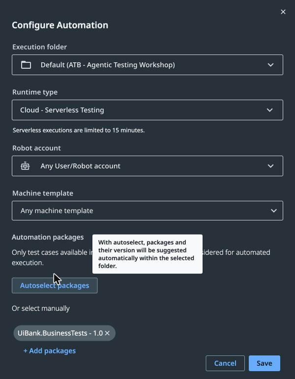

# 7. Build and Run the Regression Set

<p class="step-meta">Leads: <span class="persona-badge persona-badge--qa">QA</span> <span class="persona-badge persona-badge--uat">UAT</span> · Tools: <span class="tool-badge tool-badge--autopilot">Autopilot chat</span> <span class="tool-badge tool-badge--testmanager">Test Manager</span> <span class="tool-badge tool-badge--robot">Robot</span></p>

<div class="flow">
  <a class="flow-step" href="#what-mcp-means-for-you">Read what MCP means</a>
  <span class="flow-arrow"></span>
  <a class="flow-step" href="#label-the-test-cases-and-build-the-set">Label and build the set in chat</a>
  <span class="flow-arrow"></span>
  <a class="flow-step" href="#configure-the-automation">Configure the automation</a>
  <span class="flow-arrow"></span>
  <a class="flow-step" href="#run-the-set">Run the set</a>
  <span class="flow-arrow"></span>
  <a class="flow-step" href="#triage-the-results-in-chat">Triage in chat</a>
</div>

**Why it matters for you:** a QA manager can organize and run a release regression without code or clicking through grids, and a UAT tester gets a first opinion on every failure in a minute. You still check both against **Execution**.

Autopilot chat labels your three linked test cases and builds the release regression set for you. You run the set on a cloud robot, then ask chat to triage the result.

!!! info "Before you start"
    ✅ **Submit Standard Loan Request**, **Submit Underage Request** and **Submit Over-65 Request** show **UiBank.BusinessTests** in the **Package Name** column, from [6. Automate with Studio Web](06-automate-with-studio-web.md#check-the-package-name-column).

    ✅ Your project is open. Autopilot chat opens from the **Autopilot** icon (the sparkle, top right), set to **Edit** mode, as in [step 1](01-import-and-meet-autopilot-chat.md#open-autopilot-chat).

## What MCP means for you

So far, chat mostly read your project. In this step it **changes** it for the first time: it adds labels and creates a test set. Read this box before you type.

!!! info "MCP in plain words"
    **Tools.** To read or change anything in Test Manager, chat uses approved actions called **tools**, such as "add labels" or "create a test set". A set of tools is an **MCP server**. MCP (Model Context Protocol) is the standard plug that connects an AI assistant to a system like Test Manager. Test Manager comes with its own MCP server, so there is nothing to set up. You can see it under Autopilot → ⚙ **Chat settings** → **MCP Servers** → **From your organization** → **Test Manager MCP server**.

    **What you'll see.** Before each tool runs, chat shows a card with the tool's name and "via MCP server: testmanager". Today you meet these:

    ✅ `Bulk_add_labels` – adds a label to several test cases at once

    ✅ `Create_test_set` – creates the test set

    ✅ `Assign_test_cases_to_test_set` – puts the test cases in it

    ✅ `Get_test_executions` – reads run results, for the triage

    **You approve each one.** In **Edit** mode, every tool card waits for **Accept** or **Reject** – reads included, not only changes. One prompt can mean 3–7 clicks. Read the tool name, then select **Accept**. Built-in tools such as **Autopilot Search** and **Autopilot Chart** run without a card.

    **What it can't do today.** With the standard Test Manager tools, chat can't start, schedule or stop a run, and it can't create Execution Insights. You do those with buttons. An admin can add more tools later.

    **Cost.** Each chat turn uses your AI usage pool. Dedicated buttons, such as **Evaluate quality** or **Generate Report**, don't (<a href="https://docs.uipath.com/autopilot/other/latest/user-guide/autopilot-usage-pool-for-testing" target="_blank">Autopilot usage pool for testing</a>).

    **Safety.** Chat acts as you, so it can only do what your own Test Manager permissions allow. Every action is recorded in your organization's AI Trust Layer audit log. **Agent** mode runs tools without asking, and the docs label it experimental: stay in **Edit** mode, so nothing changes without your OK.

    More: <a href="https://docs.uipath.com/test-manager/automation-cloud/latest/user-guide/about-autopilot-chat" target="_blank">About Autopilot chat</a>.

<!-- IMG: Autopilot Chat settings → MCP Servers → From your organization → Test Manager MCP server, as a learner. Crop the header (no initials). -->

## Label the test cases and build the set

<span class="tool-badge tool-badge--autopilot">Autopilot chat</span>

A **label** is a tag on a test case, such as `release-2.4`. A **test set** is a group of test cases that run together. You label first, then let chat build the set from the label.

!!! example "It's your turn now!"
    1. Paste this into Autopilot chat and send it:

        ```text
        Add the label release-2.4 to these test cases: Submit Standard Loan Request, Submit Underage Request and Submit Over-65 Request.
        ```

        Chat asks to run `Bulk_add_labels`, then a read tool (`GetAllObjectLabelsByObjectId`) once per test case. Select **Accept** each time – about 4 clicks, about 1 minute. It answers with a table of the three test cases and their labels.

        <!-- IMG: chat tool card for Bulk_add_labels in Edit mode – tool name, "via MCP server: testmanager", Reject / Accept. Crop the header (no initials). -->

    2. Then paste:

        ```text
        Create a test set called 'Release 2.4 - Loan regression' and assign all test cases with the label release-2.4.
        ```

        Chat asks to run `Create_test_set`, `Assign_test_cases_to_test_set` and `Get_test_cases` – about 3 clicks, about 1 minute. It confirms the set and its three test cases.

    3. Type the set name with a plain hyphen, as shown: later prompts look for it by name.

!!! success "Check it"
    ✅ Before each change, chat showed the tool name and waited for your **Accept**.

    ✅ In **Test Sets**, **Release 2.4 - Loan regression** exists. On its **Test Cases** tab it lists exactly 3 test cases: Submit Standard Loan Request, Submit Underage Request and Submit Over-65 Request.

??? tip "Chat didn't work? Build the set by hand"
    1. In **Test Sets**, create a test set named `Release 2.4 - Loan regression`.
    2. On its **Test Cases** tab, under **Static Assignment**, select **Add Test Cases**, tick the three test cases and select **Assign**.

??? info "Static or Dynamic Assignment?"
    A test set gets its test cases in one of two ways:

    ✅ **Static Assignment** – pick test cases one by one. The set always runs exactly these. Chat's assign tool adds them this way.

    ✅ **Dynamic Assignment** – add labels. The set includes every test case with at least one of them, also ones you label later.

    For a release set, Dynamic Assignment on `release-2.4` keeps the set up to date by itself. Today, keep the static set chat built.

    See <a href="https://docs.uipath.com/test-manager/automation-cloud/latest/user-guide/quickstart-assigning-test-cases-to-test-sets" target="_blank">Assigning test cases to test sets</a>.

## Configure the automation

<span class="tool-badge tool-badge--testmanager">Test Manager</span>

Tell Test Manager where and on which robot the set runs. You do this once per test set.

1. Open **Test Sets** → **Release 2.4 - Loan regression** → **Test Cases** tab, and select **Configure Automation**.
2. **Execution folder** shows **Default (ATB - Agentic Testing Workshop)**, the shared folder you set as Default Folder in step 1. Leave it.
3. **Runtime type** defaults to **Cloud - VM Testing**. **Change it to Cloud - Serverless Testing.** The panel then says "Serverless executions are limited to 15 minutes." – the set needs about one.

    !!! warning "Why not the default?"
        **Cloud - VM Testing** is the shared robot that runs everyone's Run autonomously (Preview) tests from step 4. Your set would wait in its queue. **Cloud - Serverless Testing** starts fresh cloud robots for each run and doesn't wait behind the Run autonomously queue.

4. Leave **Robot account** on **Any User/Robot account** and **Machine template** on **Any machine template**.
5. Under **Automation packages**, select **Autoselect packages**. It adds **UiBank.BusinessTests - 1.0.0**.
6. Select **Save**. Test Manager confirms with **Automation details for testset saved successfully!**



??? info "Optional: formal sign-off (governance)"
    Need a signed record of the over-65 result? Test Manager can govern test results so approvers sign them.

    Want the result governed from the start? Enable it now, before **Execute** → **Automated**: **Project Settings** → **Governance** (see [9. Decide Go or No-Go](09-decide-go-no-go.md) for the settings). Forgot? You can still govern the result afterwards – step 9 shows how.

## Run the set

<span class="tool-badge tool-badge--testmanager">Test Manager</span> <span class="tool-badge tool-badge--robot">Robot</span>

With the standard Test Manager tools, chat can't start a run, so you use the button.

1. On the test set, select **Execute** ▾ → **Automated**.

    

2. Nothing pops up. Go to **Execution**: the run appears as **Automated - Release 2.4 - Loan regression -** followed by the date and a number.
3. Wait about 45 seconds, plus a short queue if the whole class runs at once. Refresh until the header says **Finished**.

!!! success "Check it"
    ✅ The header reads **2 passed / 1 failed / 0 not executed** (0 none).

    ✅ **Submit Standard Loan Request** and **Submit Underage Request** passed. **Submit Over-65 Request** failed.

    ✅ Open the failed **Submit Over-65 Request** result. Its log shows a failed verification: the test expected UiBank's rejection ("Sorry…") and UiBank answered "Congrats!". That is an **assertion** – UiBank gave the wrong answer – not a robot error.

    <!-- IMG: Execution "Automated - Release 2.4 - Loan regression - <date>" – Finished, 2 passed / 1 failed / 0 not executed, three rows (Over-65 Failed). Crop the header and the Machine/Robot columns (no initials, no account names). -->

!!! warning "Failed is not always UiBank's fault"
    A robot problem also shows as **Failed**. If the log says something like **Failed to start browser**, or all three failed, it's the robot, not UiBank: tell your trainer. See [Troubleshooting](../module-3-troubleshooting-and-next-steps/02-troubleshooting.md#runs).

    If you or your trainer look at **Orchestrator → Jobs**, the over-65 job shows as **Faulted**. That is how Orchestrator reports a failed assertion – it isn't a robot error either.

## Triage the results in chat

<span class="tool-badge tool-badge--autopilot">Autopilot chat</span>

A failed test doesn't always mean a broken app: the test itself can expect the wrong result. You made this call by hand in step 4. Now ask chat to check the failure against the requirement.

!!! example "It's your turn now!"
    1. Paste into Autopilot chat:

        ```text
        For the latest execution of Release 2.4 - Loan regression: give me the totals passed, failed and none. For each failed test case, compare its test data and expected result with the acceptance criteria of the Submit Loan Request requirement. Say whether UiBank breaks the requirement (UiBank defect) or the test expects the wrong result (test defect), and quote the criterion.
        ```

    2. Accept each tool card: chat reads the test set, the requirement, the execution, the failed log, the test steps and the parameters. About 7 clicks, about 2 minutes.
    3. Compare its answer with **Execution**. Chat can miscount, so the page is the truth.

!!! success "Check it"
    ✅ Chat's totals match **Execution**: 2 passed, 1 failed, 0 none.

    ✅ Chat calls **Submit Over-65 Request** a **UiBank defect** and quotes the over-65 criterion: applicants over 65 are rejected with "Not approved due to age." UiBank approved a 66-year-old, so the test is right and UiBank is wrong. Your own test case's steps may use another age over 65: the verdict is the same.

    ✅ The success rate is passed out of passed + failed: 2 / (2 + 1) = **66.7%**. You decide go or no-go in step 9 – on the defect, not on this number.

    Chat calls it a test defect? Ask it to check the test case against the over-65 criterion again, and tell your trainer.

??? tip "Optional: a second opinion with Autopilot Search"
    Ask chat:

    ```text
    Find all failed test case logs in the latest execution of Release 2.4 - Loan regression.
    ```

    It uses **Autopilot Search** (no tool card) and should list **Submit Over-65 Request** only. Compare the list with **Execution**. See <a href="https://docs.uipath.com/autopilot/other/latest/user-guide/search-test-manager-project" target="_blank">Search Test Manager project</a>.

??? tip "Prefer Delegate?"
    Delegate can triage the same run from your desktop. Replace `<PROJECT_PREFIX>` with your project's prefix, then paste in your Delegate session:

    ```text
    Summarize and triage the latest execution of the test set Release 2.4 - Loan regression in my Test Manager project <PROJECT_PREFIX>. Don't start a new run. Give me the totals: passed, failed and none. For each failed test case, compare its input data and expected outcome with the acceptance criteria of the Submit Loan Request requirement. Classify it as a UiBank defect (the app breaks the requirement) or a test defect (the test expects the wrong result), and quote the criterion you used.
    ```

    Approve each request when Delegate asks.

??? example "Optional: schedule the set (QA)"
    A regression set earns its keep when it runs every night or every morning before work. Schedules start automated runs only, never autonomous ones.

    1. On the test set, select **Execute** ▾ → **Create Schedule**.
    2. Fill in **Schedule** (a name, for example `Release 2.4 - weekday morning`). **Test Sets** is already filled in.
    3. Pick a **Schedule Type**:
        - **Recurrence** → daily at 06:00, or
        - **Advanced** → paste the cron expression `0 0 6 ? * MON-FRI` (06:00, Monday to Friday).
    4. Set **Start Date**, the time and your **Time zone** (the default is UTC), and save.
    5. **Deactivate it right away**, so it doesn't run every day after the workshop: go to **Execution** → **Schedules**, open the schedule's **More Options** (⋮) and select **Deactivate**. Can't find Deactivate? Delete the schedule from the same menu, or tell your trainer.

    <!-- REHEARSE: save a Recurrence schedule and Deactivate it – HANDOFF item 8 -->

    See <a href="https://docs.uipath.com/test-manager/automation-cloud/latest/user-guide/creating-schedules" target="_blank">Creating schedules</a> and <a href="https://docs.uipath.com/test-manager/automation-cloud/latest/user-guide/deactivating-schedules" target="_blank">Deactivating schedules</a>.

## Nice work!

Chat labelled your test cases and built the release set, a cloud robot ran it in under a minute, and you know the one failure is UiBank's. Next, turn the results into reports.

---

[Next → 8. Read the Results](08-read-the-results.md){: .md-button .md-button--primary}

---
