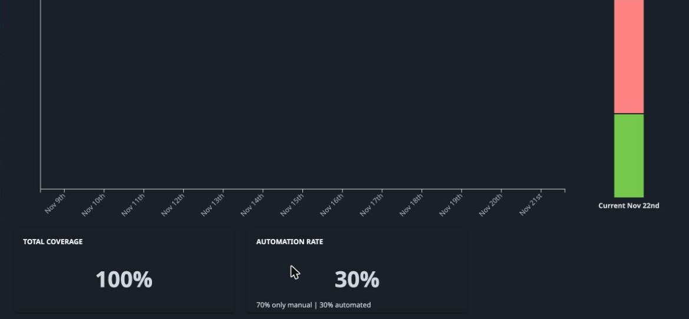
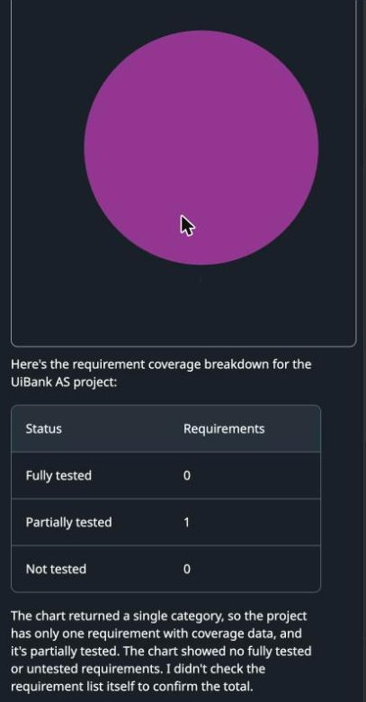
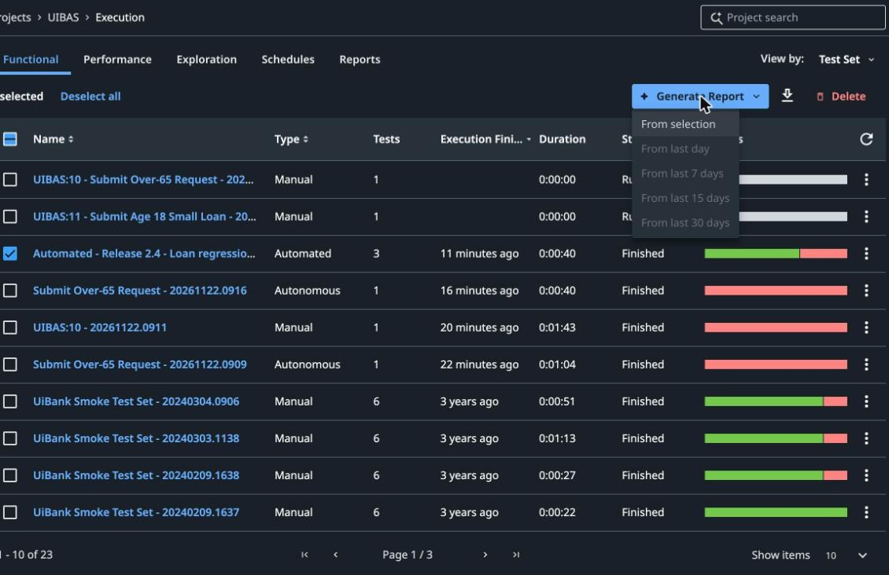
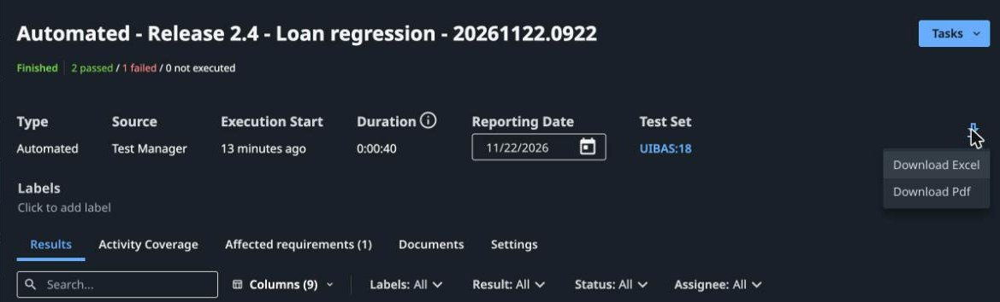

# 8. Read the Results

<p class="step-meta">Leads: <span class="persona-badge persona-badge--qa">QA</span> · Tools: <span class="tool-badge tool-badge--testmanager">Test Manager</span> <span class="tool-badge tool-badge--autopilot">Autopilot chat</span></p>

<div class="flow">
  <a class="flow-step" href="#read-the-dashboard">Read the Dashboard</a>
  <span class="flow-arrow"></span>
  <a class="flow-step" href="#check-the-requirement">Check the requirement</a>
  <span class="flow-arrow"></span>
  <a class="flow-step" href="#ask-autopilot-chat-for-charts">Ask Autopilot chat for charts</a>
  <span class="flow-arrow"></span>
  <a class="flow-step" href="#generate-the-execution-insights-report">Generate the Execution Insights report</a>
  <span class="flow-arrow"></span>
  <a class="flow-step" href="#download-the-execution-pdf">Download the execution PDF</a>
</div>

**Why it matters for you:** a release manager doesn't read test logs. They want coverage, a trend and a short list of what broke. This step turns today's runs into that evidence, and saves the execution PDF you'll attach in step 9.

You ran the over-65 test case three ways and the regression set once. Now read the results the way a QA (Quality Assurance) manager does: first the big picture, then the requirement, then the failures.

## Read the Dashboard

1. In your project, open **Dashboard**.
2. Look at **Results Overview**. You can switch between **Daily** and **Weekly**, nothing else.

    !!! info "Where is the imported history?"
        The 17 executions you imported in step 1 are about 3 years old, and the Dashboard only shows recent weeks. It has no custom date range, so the imported results never appear. The chart starts with **today's runs**: your manual run, the Delegate run, the autonomous run and the regression set.

3. Read the two tiles:

    ✅ **TOTAL COVERAGE** – the share of requirements that have at least one test case. Your project has one requirement with test cases, so it shows 100%.

    ✅ **AUTOMATION RATE** – how many of your test cases are automated and how many are manual. Only the 3 you linked in step 6 are automated, so most of the project is still manual – for example "70% only manual | 30% automated".

!!! warning "100% coverage doesn't mean ready"
    **TOTAL COVERAGE** counts test cases that *exist*, not test cases that *passed*. Your requirement is 100% covered, yet one of its acceptance criteria fails. Never report coverage as readiness.



??? info "For your admin: more reporting"
    Two things you won't see today. The **Open Defects** tile appears only when the project is connected to a defect tracker such as Jira. Trend dashboards across projects need the Insights service. See <a href="https://docs.uipath.com/test-manager/automation-cloud/latest/user-guide/test-manager-dashboard-reports" target="_blank">Dashboard reports</a>.

## Check the requirement

A release is approved requirement by requirement, so look at the results from that angle too.

1. Open **Requirements** → **Submit Loan Request**.
2. Open the **Test Cases** tab. These are the test cases that prove this requirement.
3. Find **Submit Over-65 Request**. It belongs here, because it tests the over-65 acceptance criterion.

!!! tip "Submit Over-65 Request isn't in the list?"
    Then the requirement doesn't know about its failure, and neither do the charts and reports below. On the requirement page, select **Assign test case**, and add **Submit Over-65 Request**.

## Ask Autopilot chat for charts

Autopilot chat can draw a chart or a table from your project in a few seconds. Open your project, click **Autopilot** (the sparkle icon, top right) and keep the mode on **Edit**.

!!! example "It's your turn now!"
    Send these three prompts, one at a time. Wait for each answer before you send the next one.

    1. **Coverage chart**

        ```text
        How many requirements are fully, partially, or not tested?
        ```

        Chat uses its **Autopilot Chart** tool: a pie chart and a table – **Fully tested** 0, **Partially tested** 1, **Not tested** 0. Your one requirement, **Submit Loan Request**, is **Partially tested**: the test cases you generated in step 3 are linked, but most haven't run yet. It's a built-in tool, so there's nothing to approve, and it takes under a minute. Read what chat adds under the chart: "tested" means the linked test cases ran, not that every scenario is covered.

    2. **Failures by requirement**

        ```text
        Show a chart of failed test cases grouped by requirement.
        ```

        Keep the word **chart** in the prompt. Without it, chat searches and gives you a list instead. Chat draws a bar chart and a table with the **count** of failed test cases per requirement: **Submit Loan Request** with 1 failed test case. There's nothing to approve. The chart doesn't name the test case: click the suggestion under the answer, **Show the failed test case for** your requirement key, to see that it's **Submit Over-65 Request**.

    3. **Your regression set as a table**

        ```text
        List the test cases in Release 2.4 - Loan regression in a table with their labels and their result in the latest execution of that set.
        ```

        Chat reads the test set, the test cases, the execution, the logs and the labels of each test case, so in Edit mode you select **Accept** about 7 times. It takes about 1–2 minutes. You should get 3 rows, each with the label **release-2.4**: Submit Standard Loan Request and Submit Underage Request **Passed**, Submit Over-65 Request **Failed**, and a summary: 2 passed, 1 failed, 0 not run.



!!! warning "Check the AI's numbers"
    Chat can miscount. Before you put a number in front of a release manager, compare it with **Execution**. The footer of the chat says it too: "Autopilot can make mistakes. Please double check the responses."

## Generate the Execution Insights report

**Execution Insights** is an Autopilot report on *why* tests fail: the top failing tests, common errors and recommendations. You start it with a button, not in chat. With the standard tools, chat can't create this report, and a dedicated Autopilot button doesn't use your AI usage pool (<a href="https://docs.uipath.com/autopilot/other/latest/user-guide/autopilot-usage-pool-for-testing" target="_blank">Autopilot usage pool for testing</a>).

1. Open **Execution** → **Functional**.
2. Tick the checkbox of your regression execution, **Automated - Release 2.4 - Loan regression - …**
3. Select **Generate Report** ▾ → **From selection**.

    No row ticked? **From last day** works too: it picks up everything you ran today. Don't use the longer periods to reach the imported history – it's too old to be included.

4. You see "Report generation is in progress", and the page switches to the **Reports** tab by itself, with the status **Processing**. The report is usually ready in under a minute. No report after 2–3 minutes? Ask your trainer for the reference Insights report and carry on.
5. Open the report and read its sections: **Overview**, **Top Failing Tests**, **Common Errors**, **Error Patterns** and **Recommendations**.

    Under **Common Errors** you should read something like "The application for an applicant over 65 was accepted instead of rejected…".

6. Select the download icon (tooltip **Download**). You get a `.docx` file with a long, random-looking name. Rename it, for example `UiBank-Execution-Insights.docx`, and share it with the developers – it's triage input, not release evidence.



!!! info "Insights is for triage, not for the release decision"
    The report explains failure patterns. It doesn't tell you whether to ship. Its **Recommendations** are written for developers (unit tests, logging, and so on): pass them on, but don't treat them as your verdict. See <a href="https://docs.uipath.com/autopilot/other/latest/user-guide/test-result-analysis" target="_blank">Test result analysis</a>.

## Download the execution PDF

The execution PDF is the plain, factual record of the run: no AI, just results. It's the evidence you attach to a sign-off.

1. In **Execution** → **Functional**, open your regression execution, **Automated - Release 2.4 - Loan regression - …**
2. On the execution page, select the download icon → **Download Pdf**.

    Use the icon on the *execution* page. The icon on the **Execution** list exports every execution to Excel.

3. Save the file (`<PREFIX>-TestResults-<date>_<time>.pdf`, with your project prefix) next to your Insights report.

Open it and check:

✅ **Summary: 2 Passed / 1 Failed / 0 None**

✅ **Assertions** – Submit Over-65 Request failed its check: UiBank showed "Congrats!" where the test expected "Sorry"

✅ **Requirements** – Submit Loan Request with its test cases and their results



## Check it

!!! success "Check it"
    ✅ Chat's failures chart shows 1 failed test case under **Submit Loan Request**, and the suggestion names it: **Submit Over-65 Request**.

    ✅ The Execution Insights `.docx` and the execution PDF are saved on your computer.

    ✅ You can explain in one sentence why 100% coverage doesn't mean ready, and why Execution Insights is triage, not a release summary.

!!! question "Think about it"
    Which of today's numbers would you show a release manager, and which would you keep for the test team? Which one could mislead them if you showed it alone?

## Nice work!

You read the results from three angles – Dashboard, requirement and failures – checked the AI's numbers, and saved the evidence for the decision.

---

[Next → 9. Decide Go or No-Go](09-decide-go-no-go.md){: .md-button .md-button--primary}

---
