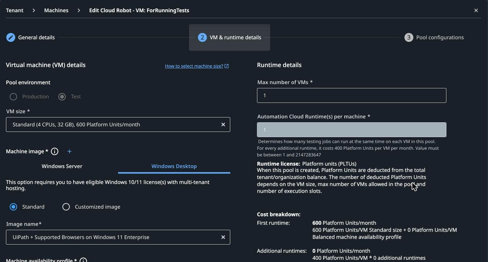
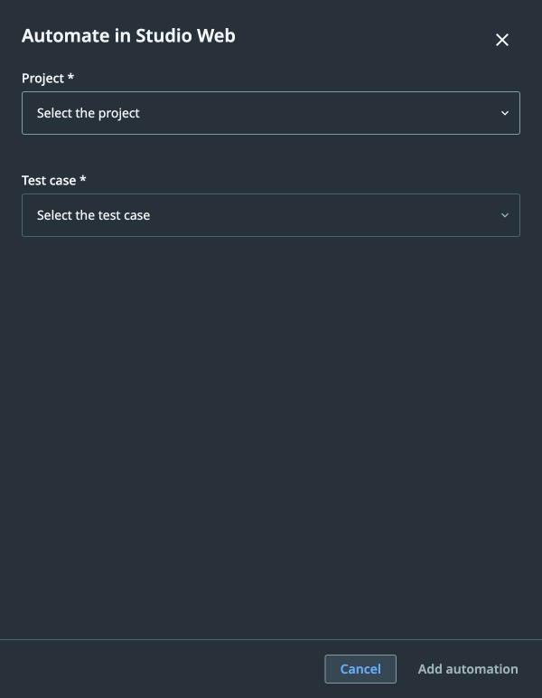

# Trainer Setup

Complete this page **a few days before the workshop**, then run the [day-before checklist](#day-before-checklist). It sets up one shared folder, two kinds of cloud robot, a Trainer Demo project with a published Studio Web package, and the backups you need if something fails in class.

!!! note "Where these steps come from"
    Most steps below were done and checked on a Test Cloud tenant in November 2026, with one trainer account and one learner-like account. Steps marked **not tested** or **re-checked in the rehearsal** were not – check them with a learner-only account before the class. Use **your Test Cloud host** wherever the guide says `<host>`. Labels may differ slightly on your tenant, and **(Preview)** features may change.

**What you build**

| Object | Name used in the guide | Used in |
|---|---|---|
| Shared Orchestrator folder | **ATB - Agentic Testing Workshop** (plain hyphen) | every step (Default Folder, step 1) |
| Robot account | one unattended robot account, for example *ATB Workshop Robot* | steps 4, 5, 7 |
| Cloud Robot – VM pool | runtime type **Cloud - VM Testing** | steps 4 and 5 (Run autonomously, Autonomous Exploration) |
| Cloud Robot – Serverless machine | runtime type **Cloud - Serverless Testing** | step 7 (regression set) |
| Trainer Demo project | your own name and prefix, for example *ATB Trainer Demo* | demos and backups |
| Studio Web Tests project and package | `UiBank.BusinessTests` | steps 6 and 7 |

## Organization and tenant

✅ **A Test Cloud organization on Unified Pricing.** Autopilot chat, its charts, Run autonomously, Autonomous Exploration, governance and running a test case without a test set need Test Manager on **Test Cloud**. They aren't available on Flex licensing.

✅ **Learners can join the organization.** Either the organization allows **external users** (learners sign in with their own accounts), or you invite learners with company accounts.

✅ **Services:** the tenant has **Test Manager**, **Orchestrator** and **Studio Web** enabled.

✅ **Licence plan:** open **Admin → Licenses** and check which plan the organization is on. It decides how much AI each learner gets (see [Licences and usage](#licences-and-usage)).

✅ **AI Trust Layer policy:** in **Automation Ops → Governance**, an AI Trust Layer policy is active and deployed to the tenant, with **Feature Toggles → Enabling Test Manager features** set to **Yes**. **User License Management** is enabled for the organization. In **Admin → AI Trust Layer → Model hub**, check that no strict data-residency rule blocks the models Test Manager uses. See <a href="https://docs.uipath.com/test-manager/automation-cloud/latest/user-guide/about-autopilot-chat" target="_blank">About Autopilot chat</a> and <a href="https://docs.uipath.com/autopilot/other/latest/user-guide/enable-disable-functionality" target="_blank">Enabling/disabling Autopilot</a>.

✅ **Automation Ops Autopilot policy:** if your organization uses one, check that it doesn't block the Test Manager tools or MCP servers (it controls tools, MCP servers, security mode and models). Learners use the built-in **Test Manager MCP server** in step 7. See <a href="https://docs.uipath.com/autopilot/other/latest/user-guide/architecture-and-data-flow" target="_blank">Architecture and data flow</a>.

✅ **Automation Ops Assistant policy:** check that Delegate isn't switched off for learners, and that the approval mode isn't locked to a setting that blocks the exercises. See <a href="https://docs.uipath.com/automation-ops/automation-cloud/latest/user-guide/settings-for-assistant-policies" target="_blank">Settings for Assistant policies</a>.

!!! success "Check it"
    With a learner-like account: open any Test Manager project and check that the **Autopilot** icon is in the top bar (it isn't on the project list). Open a requirement → **+ Evaluate quality** is available.

## Users and licences

✅ **Your trainer account:** your own account needs an **App Test Developer** licence, the **Project Creator** tenant role in Test Manager, **Folder Administrator** on the workshop folder, and tenant-level rights to publish packages: the tenant role **Allow to be Automation Publisher** plus a folder role that can publish, such as **Automation Publisher** (both labels confirmed on the rehearsal tenant). On your laptop, install UiPath Assistant signed in to the same tenant, and the UiPath Studio Web browser extension, for **Indicate target** and the Autopilot Recorder.

✅ Create a **group** for the learners, invite each learner to the organization, and add them to the group. Give rights and licences to the **group**, so late joiners get everything at once.

✅ **Licence:** allocate **App Test Developer** to the group (**Admin → Licenses**). **App Tester** is the minimum: it has Autopilot chat and Delegate, but can't build in Studio Web. Never use **Express User**. Autopilot chat in Test Manager isn't included with a **Pro** licence. See <a href="https://docs.uipath.com/test-manager/automation-cloud/latest/user-guide/user-licenses" target="_blank">User licenses</a>.

✅ **Test Manager:** give the group the **Project Creator** tenant role, so each learner can import and own a project in step 1.

!!! info "Tenant role, not a project role"
    **Project Creator** is a **tenant** role. No Test Manager project role can create projects. The learner who imports the project becomes its owner and can set the **Default Folder** and use governance without extra grants. See <a href="https://docs.uipath.com/test-manager/automation-cloud/latest/user-guide/tenant-roles-and-project-roles" target="_blank">Tenant roles and project roles</a>.

✅ **Orchestrator access rule for the group:** in Orchestrator, at the **Tenant** level, open **Manage access** (**Access → Access rules** in the new layout) → **Assign access** → **Groups**, pick the group, and:

<div class="indent" markdown>

✅ under **Roles**, add **Allow to be Automation User** (learners don't publish, so they don't need Automation Developer or Publisher)

✅ under **Settings**, set **Personal automation setup** to **Enable personal automation** (with or without Personal workspace). Delegate needs Personal Automation.

</div>

{ width="400" }

*The screenshot comes from a developer workshop and shows broader roles. For this workshop, **Allow to be Automation User** is enough – it carries **Packages – View**, which **Select Automation** needs to list the Tenant Package Feed. See [Proven minimum rights](#proven-minimum-rights).*

!!! success "Check it"
    In **Admin → Licenses → Users**, each learner has **App Test Developer** (or **App Tester**), directly or through the group. No Autopilot icon for a learner inside a project? This row is the first thing to check.

### Licences and usage

| Item | What to check |
|---|---|
| **AI and Agentic usage pool** | Each chat turn and each Delegate task uses the learner's monthly pool. Autopilot buttons (Evaluate quality, Generate tests, Generate Report) don't. On an **Enterprise** plan, App Tester gets 7x the Basic pool and App Test Developer 20x. On **Basic** and trial plans, every licence except Express User gets the same Basic pool. When the pool is spent, Autopilot and Delegate pause: there is no fallback to paid units. Budget per learner: about 11 chat turns, plus 4–5 Delegate tasks. On a Basic or trial plan, UiPath's own estimate puts the Basic pool at about 4 chat tasks and 2 standard Delegate tasks a month, below the 4–5 the workshop uses. Plan a top-up for every learner, or run the Delegate parts as trainer demos. See <a href="https://docs.uipath.com/delegate/standalone/latest/user-guide/methodology-for-usage-estimates" target="_blank">Methodology for usage estimates</a> and <a href="https://docs.uipath.com/test-cloud/automation-cloud/latest/admin-guide/usage-pool-consumption-for-autopilot-delegate-and-cartographer" target="_blank">Usage pool consumption</a> |
| **Top-ups** | Granting a top-up needs the **License Administrator** role and Platform Units in the organization's distribution. One pack = 50 Platform Units, and granted packs can't be returned. Option for a class: turn on **Automatic License Top-Up Grant** (Preview) in the AI Trust Layer policy. Bring your own model (BYOM) for Delegate, if your organization allows it, avoids the pool. See <a href="https://docs.uipath.com/test-cloud/automation-cloud/latest/admin-guide/granting-ai-and-agentic-usage-top-ups" target="_blank">Granting AI and agentic usage top-ups</a> |
| **App Test Platform Units** | Run autonomously and Autonomous Exploration need an active App Test Platform Units bundle on the tenant. The docs publish no rate per run: note the balance before and after the pre-warm runs. See <a href="https://docs.uipath.com/test-manager/automation-cloud/latest/user-guide/autonomous-test-execution" target="_blank">Autonomous test execution</a> |
| **Platform Units for robots** | The Cloud Robot – VM pool deducts Platform Units per month from the tenant balance; serverless robots are billed per minute. See <a href="https://docs.uipath.com/robot/automation-cloud/latest/user-guide/machine-sizes-and-costs" target="_blank">Machine sizes and costs</a> |

??? note "Trainer FAQ: \"Do the buttons really cost nothing?\""
    The learner pages cite only the testing usage-pool page, which says a capability called through its own button never uses the pool. A different page, *Autopilot for Everyone licensing*, describes the older Autopilot for Everyone meter (0.2 Platform Units per action after a monthly limit). If a sharp learner or admin finds it, that is the explanation. See <a href="https://docs.uipath.com/autopilot/other/latest/user-guide/autopilot-usage-pool-for-testing" target="_blank">Autopilot usage pool for testing</a>.

## The shared folder

All learners work in **one** Orchestrator folder. They do no Orchestrator work themselves: they only pick this folder as their project's **Default Folder** in step 1.

!!! tip "Orchestrator asks you to choose a layout?"
    This page uses the classic tab names (**Folders**, **Machines**, **Manage access**), with the new-layout name in brackets. See the <a href="https://docs.uipath.com/orchestrator/automation-cloud/latest/user-guide/new-layout-navigation-map" target="_blank">New layout navigation map</a>.

1. In Orchestrator, at the **Tenant** level, open **Folders** (**Access → Folder management**).

    

2. Click the new folder icon next to **Manage Folders**.

    { width="400" }

3. Enter the **Name** `ATB - Agentic Testing Workshop` with a **plain hyphen** (learners type it in a search box), keep **Process packages source** as **Tenant package feed**, and click **Create**.

    { width="400" }

    !!! warning "Create it where learners get no inherited roles"
        Create the folder at the root, or under a parent folder where the learner group has no role. A folder under a parent where a learner group is **Folder Administrator** inherits that role, gives learners admin rights, and hides any rights problem until a real class.

4. Create a custom folder role for learners: Orchestrator → **Tenant** → **Roles** (**Access → Roles**) → **Add role** → type **Folder**, name it for example *ATB Workshop Learner*, and grant only the **View** permission for subfolders (API name `SubFolders.View`; the role editor lists it under **Subfolders** or **Folders**, depending on the layout).
5. Open the folder → **Manage access** → **Assign account/group/external app**:
    - the learner group (or each learner): folder roles **Automation User** and your learner role from item 4
    - your trainer or admin group: **Folder Administrator**

    In the rehearsal, Test Manager's **Default Folder** picker listed the folder only after a **direct** folder assignment for the learner. A group assignment wasn't tested: check it with a learner account.

6. Select **Check own permissions** and tick **View Inherited Users** to see the effective rights.

    

### Proven minimum rights { #proven-minimum-rights }

Rehearsed on 2026-11-22 with a learner account that had no admin role anywhere:

| Where | What the learner needs | Why |
|---|---|---|
| Licence | **App Test Developer** (or **App Tester**), direct or through the group | Autopilot, Autopilot chat, Delegate |
| Tenant – Orchestrator | **Allow to be Automation User** (through the learner group) | **Packages – View** for **Select Automation** (Tenant Package Feed) |
| Tenant – Test Manager | **Project Creator** (through the learner group) | Import and own a project (step 1) |
| Workshop folder | **Automation User** + the learner role with subfolder **View** (items 4–5 above) | Default Folder, Run autonomously, serverless runs |

With exactly these rights, all of these worked: Default Folder (save and reload), Run autonomously (package upload, process create, job – one run passed in 7 min 50 s), **Select Automation** and **Save** from the Tenant Package Feed, the serverless regression set (2/1/0), the chat write tools **Bulk_add_labels**, **Create_test_set** and **Assign_test_cases_to_test_set**, Execution Insights, the PDF download, a deactivated schedule, and governance with the learner as their own approver.

!!! warning "Without the subfolder View permission"
    With **Automation User** alone, the Default Folder picker lists the workshop folder and **Save** works, but **Project Settings** then shows the toast **Folder does not exist.** and the **Default Folder** field is blank after a reload. Add the learner role from item 4 and reload – no change in the learner's project is needed.

!!! warning "Button-made suggestions can't be applied by learners"
    Suggestions created by the **+ Evaluate quality** button returned a rights error when the learner clicked **Add to Requirement** or changed a status ("You do not have the necessary rights to access this application.", with a **Click here to logout** button – `PATCH …/llmactivity` = 403), also with the old admin group restored for a test. Suggestions created through **Autopilot chat** (the same evaluation, via the chat prompt and its **Review** button) could be applied and their status changed, in the new and in the old learner project. Step 2 sends learners to the chat route when the error appears.

To link an automation for a learner (step 6 fallback), do it at their desk, in their browser and their project. Or ask them to add you in their project's **Project Settings → Manage Access → Assign users/groups** with the **Test Manager Administrator** project role (project role labels seen: **Project Owner**, **Test Manager**, **Viewer**, **Test Manager Administrator**).

??? note "Fallback: one folder per learner"
    If one shared folder doesn't suit your tenant, create one folder per learner, and add the robot account and both machines to each folder. It costs about 4 minutes of setup per learner.

## Robot account

Learners' run panels pick **Any User/Robot account**. The folder needs one account that can run **unattended** jobs, or runs stay **Pending**.

1. Create a robot account, for example *ATB Workshop Robot* (**Admin → Accounts & groups → Robot accounts**; labels may differ).
2. In the workshop folder → **Manage access** → **Assign account/group/external app**, add the robot account with the folder role **Automation User**. If the panel asks for a tenant role, add **Allow to be Automation User**.
3. Check that its **Robot Type** shows **Unattended**.

## Robots

Learners use two kinds of cloud robot. You don't install anything on learner laptops.

| Robot | Runtime type | Runs | Who starts it |
|---|---|---|---|
| **Cloud Robot – VM** pool, Windows 11 | **Cloud - VM Testing** | Run autonomously (step 4), Autonomous Exploration (step 5 demo) – both (Preview) | each learner (Run autonomously); you (Exploration) |
| **Cloud Robot – Serverless** | **Cloud - Serverless Testing** | the automated regression set (step 7) | each learner |

### Cloud Robot – VM pool for Run autonomously and Exploration

Run autonomously and Autonomous Exploration run in the machine's default browser on a **Cloud - VM Testing**, **Cloud - VM** or self-hosted testing runtime. Serverless runtimes aren't supported for them. Autonomous Exploration needs a Windows robot; this workshop uses a Windows 11 pool for both.

1. In Orchestrator, at the **Tenant** level, open **Machines** (**Infrastructure → Machines**) → **Add machine** → **Cloud Robot - VM**.

    

2. Fill in the pool. The settings that were rehearsed:

    | Setting | Value |
    |---|---|
    | Machine management | **Automatic** (VMs are created and deleted for you; changes made on a VM don't persist) |
    | Pool environment | **Test** – this gives the **Cloud - VM Testing** runtime type |
    | VM size | **Standard (4 CPUs, 32 GB)** |
    | Machine image | **Windows Desktop** → **Standard** → **UiPath + Supported Browsers on Windows 11 Enterprise** |
    | Machine availability profile | **Balanced** normally; **Always** (or **Fast**) for the workshop day – see the capacity box |
    | Max number of VMs | 1 to start; see the capacity box |
    | Automation Cloud Runtime(s) per machine | 1; see the capacity box |
    | Runtime license | **Platform units (PLTUs)** – the page shows the monthly total |
    | Pool configurations | **Allow UiPath to manage Robot updates** on (required for a standard image) |

    

3. Open the workshop folder → **Machines** → **Manage Machines in Folder**, select the pool, and click **Update**.

    

No remote desktop session, browser extension setting or **Allow in Incognito** change was needed on the standard image: Run autonomously and Exploration both worked as delivered. Autopilot drove **Edge** on the VM. The robot log warns that the VM screen resolution **1024x768** is below the recommended 1920x1080 and "ScreenPlay executions may be less accurate": if runs misread the page, raise the resolution as the warning's docs link describes. See <a href="https://docs.uipath.com/robot/automation-cloud/latest/user-guide/running-unattended-automations-using-cloud-robots-vm" target="_blank">Running unattended automations using cloud robots – VM</a>.

!!! warning "Capacity: plan the queue before lunch"
    Measured with 1 VM and 1 runtime on **Balanced**:

    - The first job of the day waited **9 minutes** while a VM started. Balanced shuts an idle VM down again.
    - Each Run autonomously took about **6 minutes** (5 min 43 s to 8 min 14 s), **one after another** per runtime. One runtime handles about 9–10 runs an hour.

    Learners start Run autonomously at the start of step 4, so the queue drains over lunch. Aim for one VM per **4–5 learners** (15 learners → 3 VMs). Both settings show their cost on the pool's edit page:

    - **Max number of VMs:** the lever to use. Each VM runs one browser job at a time and adds the VM size's monthly cost (600 Platform Units for Standard). For 15 learners, set 3 VMs.
    - **Automation Cloud Runtime(s) per machine:** leave at 1. The docs describe parallel jobs on extra runtimes for background processes only, and Run autonomously drives a browser. Each extra runtime still costs 400 Platform Units per VM per month.

    For the workshop day, set **Always** (or start the pre-warm runs 15 minutes before class), check the Platform Units balance first, and **revert the availability profile and Max number of VMs after the class**.

!!! info "What learners see"
    The Run autonomously panel preselects **Cloud - VM Testing** on a folder with this pool. **Cloud - Serverless Testing** and **Cloud - Serverless** are selectable in the list, but not supported. The learner pages say "your trainer tells you which runtime": tell them **Cloud - VM Testing**.

### Cloud Robot – Serverless for the regression set

1. At the **Tenant** level, open **Machines** → **Add machine** → **Cloud Robot - Serverless**. Enter a name, for example *ATB Serverless*, check that **Cloud - Serverless Testing** is offered as a runtime type, and select **Provision**.
2. Open the workshop folder → **Machines** → **Manage Machines in Folder**, select the serverless machine, and click **Update**.
3. Check the serverless capacity. The rehearsed folder showed one **Cloud - Serverless Testing** runtime. In the learner-like pass, start the regression set from two projects at once and check that both run in parallel. If they queue, raise the serverless runtimes for the folder, or allow a few extra minutes in step 7.

Serverless jobs are limited to 15 minutes; the 3-test regression set takes under a minute. Studio Web Tests projects are cross-platform, so they run on serverless robots. See <a href="https://docs.uipath.com/robot/automation-cloud/latest/user-guide/executing-unattended-automations-with-serverless-robots" target="_blank">Executing unattended automations with serverless robots</a>.

!!! warning "Configure Automation may default to the VM pool"
    With both machines in the folder, a test set's **Configure Automation** panel preselected **Cloud - VM Testing** in one rehearsal and showed an empty **Runtime type** in another. Step 7 tells learners in bold to pick **Cloud - Serverless Testing** either way. A learner who misses it sends the regression run to the VM queue: cancel and run again.

### Robot-side errors

These happen on the robot, not in the learner's test. They used to be learner troubleshooting rows.

| What learners see | Cause and fix |
|---|---|
| Tests fail with "Cannot communicate with the browser" | The UiPath browser extension on the robot isn't reachable. On an automatically managed VM pool, use the standard image **UiPath + Supported Browsers on Windows 11 Enterprise**, which has the extension; on a custom image, install and enable the extension in the image. Then run again |
| Tests fail with "Failed to start browser. New browser window did not appear." | The robot opened a browser profile without the UiPath extension. Same fix as above: standard image, or a custom image with the extension on in the default profile. Then run again |
| A run stays **Pending** | The VM is starting (up to 9 minutes on Balanced), the queue is long, the folder has no unattended robot account, or a serverless runtime was picked for Run autonomously. Check **Orchestrator → Jobs** in the workshop folder |
| A regression test shows **Faulted** in Orchestrator **Jobs** | A test that fails its assertion shows as Faulted in Jobs. It isn't a robot error: check the test log in Test Manager |

## Trainer Demo project and the Studio Web package

The Trainer Demo project is your own UiBank project. It holds the published automation that learners link to in step 6, and every backup.

1. Import the workshop `.tmh` (step 1 of the learner guide) under a name and prefix of your own, for example *ATB Trainer Demo*. Set **Project Settings → Automation → Default Folder** to the workshop folder.
2. Add a manual test case **Submit Over-65 Request** with the same data as the automation (amount **50000**, term **3** years, income **90000**, age **66**). Expected result: rejected with "Not approved due to age." Link it to **Submit Loan Request**. Learners create the same test case, with the same data, in step 3.
3. Give the learner group read-only access to this project: **Project Settings → Manage Access → Assign users/groups**, pick the group, and assign the **Viewer** project role (the label shown in Manage Access). Step 5 sends learners here to read your completed over-65 run. Without it, learners don't see the project at all – the rehearsal learner lost sight of it once its admin group was removed – so show the run on the projector instead. See <a href="https://docs.uipath.com/test-manager/automation-cloud/latest/user-guide/tenant-roles-and-project-roles" target="_blank">Tenant roles and project roles</a>.

### Build the package in Studio Web

Learners link to these four tests by name, so use these names exactly:

| Studio Web test | Test data | Expected result in UiBank today |
|---|---|---|
| **Submit Standard Loan Request** | any test email, amount 50000, term 3, income 90000, age 34 | passes – "Congrats! You've been approved…" |
| **Submit Underage Request** | same, age 17 | passes – age 17 gives "Sorry, at this time you have not been approved for a loan." |
| **Submit Over-65 Request** | same, age 66 | **fails** – age 66 gets "Congrats! You've been approved…", but the requirement says reject. This is the UiBank defect behind the NO-GO |
| **Submit High-Volume Request** | amount 150000, term 3, income 500000, age 34 | **fails** – a spare: UiBank never approves loans over $100,000, although the requirement approves them when income is more than 3x the loan. The imported test case uses amount 120000 and income 90000. Change its steps 6, 8 and 11 to 150000, 500000 and "Verify 'Congrats! You've been approved…'", or chat calls its failure a test defect |

1. In Test Manager, open **Submit Standard Loan Request** → **Automation** tab → **Automate in Studio Web**.
2. In the panel, type `UiBank.BusinessTests` in **Project\*** and select **Create project "UiBank.BusinessTests"**. In **Test case\***, create the test with the test case's name. Select **Add automation**. You see "Automation updated successfully!", then **Open in Studio Web**.
3. Repeat for the other three test cases, choosing the same project.
4. In Studio Web, build each test: **Use Browser** on `https://uibank.uipath.com/loans/apply` (Chrome) → **Type Into** email, amount, income and age → **Select Item** for the term → **Click** submit → **Get Text** of the heading on the result page → **Verify Expression** that it contains "Congrats" (approve) or "Sorry" (reject). Use the test data from the table.

    Use an amount of $100,000 or less in the Over-65 test. Otherwise UiBank rejects it for the amount and the defect is hidden.

    **Indicate target** and the Autopilot Recorder need the UiPath robot on your own machine ("Please wait while we start the UI Automation process on your local machine"): install UiPath Assistant on the trainer laptop and sign in to the same tenant first.

5. Debug each test on the cloud (right-click the file → **Debug**). Standard passes ("Verification passed…"); Over-65 fails ("Verification failed. The expression 'resultHeading' with value 'Congrats!'…").
6. Select **Publish**: choose **Shared** (confirm in the rehearsal), Version **1.0.0**, and set **Location** to **Orchestrator Tenant Processes Feed** (the default differs by tenant – it was Orchestrator Autopilot Feed on the rehearsal tenant). Publish.
7. Back in Test Manager, each linked test case now shows **Package Source: Tenant Package Feed** on its **Automation** tab.

!!! info "The empty TestCase entry"
    Every Studio Web Tests project has a default **TestCase** entry point that can't be deleted. It shows up in learners' **Select Automation** list. Step 6 tells learners to ignore it.

!!! info "One editor at a time"
    A shared Tests project allows one editor at a time, so learners don't open it. They link to the published package with **Select Automation** (step 6). Opening it read-only as a learner wasn't tested.



See <a href="https://docs.uipath.com/test-manager/automation-cloud/latest/user-guide/automating-test-cases-in-studio-web" target="_blank">Automating test cases in Studio Web</a>, <a href="https://docs.uipath.com/studio-web/automation-cloud/latest/user-guide/publishing-a-project" target="_blank">Publishing a project</a> and <a href="https://docs.uipath.com/test-manager/automation-cloud/latest/user-guide/selecting-automation" target="_blank">Selecting automation</a>.

### The live demo in step 6

Demo on a test case with no automation yet, for example **Submit Short-Term Request** in the Trainer Demo project. Create a separate Tests project, for example `UiBank.DemoLive`, build or record one test and **Debug** it. Never publish `UiBank.BusinessTests` again during class – learners link version **1.0.0**, and step 7 expects it.

### Run the regression set yourself

1. In the Trainer Demo project, create the test set `Release 2.4 - Loan regression` (plain hyphen) with Submit Standard Loan Request, Submit Underage Request and Submit Over-65 Request.
2. **Configure Automation** → **Runtime type** = **Cloud - Serverless Testing**, **Robot account** = **Any User/Robot account**, **Autoselect packages** → `UiBank.BusinessTests - 1.0.0` → **Save**.
3. **Execute → Automated**. Expect **2 passed / 1 failed / 0 none** in under a minute.

## Backups in the Trainer Demo project

Keep these ready in the Trainer Demo project, so any step can fall back to them:

✅ **Completed Run autonomously runs** – from the pre-warm (below), including one of **Submit Over-65 Request** that fails at the age decision. Step 5 sends learners to it when their own run hasn't finished. Learners open it through the **Viewer** role from the setup above; if that doesn't work on the day, show it on the projector.

✅ **An Autonomous Exploration report** – from the pre-warm.

✅ **An Execution Insights report** – Execution → **Generate Report** → **From selection** on your regression run → **Reports** tab → **Download** (DOCX).

✅ **The reference execution PDF** – the regression execution's download icon → **Download Pdf**. Keep an **unsigned** copy for learners. A PDF from a signed governed log contains the signer's name and email.

✅ **A reference go/no-go report** – the step 9 chat summary of your regression run, or a Delegate PDF report made from it. Unsigned, no names. It covers step 9 if a learner's chat or Delegate fails, or if UiBank fixes the defect.

✅ **Offline copies** – save the Insights DOCX, the unsigned execution PDF, the reference go/no-go report and screenshots of each step on your laptop. If the tenant is down, walk through them on the projector. Decide before the day whether a second tenant, set up the same way, is your backup.

✅ **An Exploration charter prompt** in **Project Settings → Prompt Library**, for example "Explore only the over-65 rule of the loan application form."

??? note "Optional: governance on the Trainer Demo project"
    Shows the formal sign-off box in step 9.

    1. **Project Settings → Governance → Enable governance**: set **Default governance state** (Governed / Not governed), **Default approvers** (users or groups) and **Signing order**, then **Save**.
    2. Logs created before you enabled governance aren't governed: open the log and switch the **Governed** toggle on.
    3. Set the approval status to **In review**. This locks the log: edits are disabled until all approvers sign.
    4. On the log's **Governance** tab, sign: **Your role at time of signature\***, optional comments, **Sign**. Self-approval was allowed in the rehearsal.

    Signatures show the signer's name and email, also in the PDF: crop screenshots and don't share that PDF. See <a href="https://docs.uipath.com/test-manager/automation-cloud/latest/user-guide/testing-process-governance" target="_blank">Testing process governance</a>.

## Pre-warm the robots (the day before)

The first Run autonomously in a folder uploads a test package and creates the process `UiPathTestCloudAutonomousTestExecution`; the first Exploration creates `UiPathTestCloudAutonomousExploration`. Do these runs the day before, so the first class runs don't also start a cold VM.

1. **Run autonomously ×3** from the Trainer Demo project – Submit Over-65 Request (the step 5 backup), Submit Standard Loan Request and Submit Underage Request: test case ⋮ → **Execute Autonomously** → **Url\*** `https://uibank.uipath.com` (the test cases start on the UiBank home page), keep the recommended **Model**, **Next** → **Runtime type** **Cloud - VM Testing**, **Robot account** **Any User/Robot account** → **Run**. Note the time per run and the App Test Platform Units used.

    The panel saves the Url into the test case's **Manual Steps → URL** field and pre-fills it next time. Typing into a pre-filled field appends to it: in the rehearsal that produced `…/loans/applyhttps://…`, and the next runs ended after step 1 with "Verification could not be completed (HttpRequestException)". Clear the field before you type, or set the URL once in **Manual Steps**.
2. **Autonomous Exploration ×1:** requirement **Submit Loan Request** → **+ Autonomous Exploration**. A 10-minute time-box finished in 11 minutes and covered about **one** scenario. For the step 5 demo, use the narrow charter prompt ("only the over-65 rule"), or a 20–30 minute pre-run you show as the result.
3. Keep the completed runs and the report as backups. Check that Autopilot reached the over-65 age step and marked it **Failed**, with a screenshot of the approval page – that is the result learners compare in step 5 (the rehearsal's Trainer Demo run showed exactly that; see the warning below).

!!! warning "Check that behaviour verification works on your tenant"
    Run autonomously checks each step that has an **expected result** with a separate verification call. On the rehearsal tenant (staging, 2026-11-22) that call failed every time: **Behaviour verification** said "Verification could not be completed (HttpRequestException)", the step was marked **Failed**, and the run stopped there – about 40 seconds for a generated test case, at step 1. Steps without an expected result ran and passed. It happened for learner and admin runs alike, so it isn't a rights problem.

    What we did for the Trainer Demo backup: **Submit Over-65 Request** (ATBT:9 on the rehearsal tenant) has expected results only on the last step. Autopilot then ran steps 1–10 (Passed) and marked the decision step **Failed**, with its comment "The result page displays the decision message: Congrats! You've been approved…" and a screenshot of the approval page – the evidence step 5 needs, even though the verification call itself still reported the error.

    The day before the class, run one learner-generated test case autonomously. If its first step with an expected result fails with that error, plan Run autonomously as a trainer demo from your Trainer Demo backup, tell learners to skip item 1 of step 4, and report it to UiPath support with the execution link.

## Send learners the prerequisites

✅ Send these **one week ahead**. Replace `<host>`, `<ORG>` and `<TENANT>` with your Test Cloud host, organization and tenant. Ask each learner to reply with a screenshot of Delegate showing the tenant.

!!! info "Prerequisites to send learners"
    <div class="rich-copy" markdown>

    ```text
    SYSTEM REQUIREMENTS
    --8<-- "system-requirements.md"
    ACCESS AND SETUP (about 30 minutes)
    1. Sign in at https://<host>/<ORG>/<TENANT>
       - Open Test Manager. The project list may be empty.
       - Allow pop-ups for the site.
    2. Install UiPath Assistant with Delegate
       - Windows: in the installer, select only "Assistant, Delegate & Cartographer"
       - Mac: Delegate for macOS (Preview), Apple silicon, macOS 14 or later
    3. In Assistant, sign in to <ORG> / <TENANT>. In Delegate, choose the QA / Testing profile.
    4. Connect Delegate to Test Manager (one time, about 5 minutes):
       follow the "Connect Delegate to Test Manager" section of the guide's
       Prerequisites page, with these values:
       - host: <host>
       - organization: <ORG>
       - tenant: <TENANT>

    VERIFICATION
    - Delegate answers "List the tenant I am connected to." with <ORG> / <TENANT>
    - The UiPath extension is enabled in the browser profile you'll use
    - Reply with a screenshot of that Delegate answer
    - If step 4 fails, send a screenshot and bring your laptop 30 minutes early
    ```

    </div>

!!! warning "Check the Delegate connection on real laptops"
    The connection step was checked against the docs and the official installers, not yet on a learner laptop. Before the first class, spend 15 minutes on one Windows and one Mac laptop: Windows package manager allowed, the admin prompt for Node.js, the company proxy, the browser sign-in, Delegate finding the tool after Assistant restarts, the **QA / Testing** profile, and the Delegate for macOS (Preview) DMG.

??? note "Mac learners"
    ✅ **Machine:** Apple silicon (M1 or later), macOS 14 Sonoma or later. Intel Macs aren't supported.

    ✅ **Delegate for macOS (Preview):** DMG for Enterprise organizations, PKG for Community. Tell Mac learners which installer to use and where to get it: point them to <a href="https://docs.uipath.com/delegate/standalone/latest/user-guide/installation" target="_blank">Install and update</a> (Enterprise: `UiPath Assistant (arm64).dmg`; Community: the UiPath Platform Installer for macOS PKG). Put the exact download link in the prerequisites message. If it doesn't work, the learner uses the browser path and pairs with a neighbour for the Delegate parts.

    ✅ Everything else runs in the browser or on your cloud robots.

## Known caveats

✅ **The sample project pre-fills old values.** The `.tmh` pre-fills Name **UiBank Project**, Prefix **UIBWS**, and a description written for a developer workshop. Step 1 tells learners what to type instead. Re-export a business-version `.tmh` when you can.

✅ **Imported history is 3 years old.** The Dashboard (Daily / Weekly only, no custom date range) never shows it, and Execution Insights "From last N days" ignores it. Step 8 uses **From selection** or **From last day**.

✅ **Imported results show the original tester's name** under **Executed By**. Crop it from any screenshot you share.

✅ **Chat Edit mode asks Accept / Reject for every tool call**, reads included: about 5 clicks for the overview prompt, 5–7 for the triage prompt and 7 for the step 8 table prompt. The learner pages warn about it.

✅ **No chat tool starts, schedules or stops runs, or creates Execution Insights** with the standard Test Manager tools. Learners use the buttons for those.

## Suggested agenda

The **Rehearsal** column is the clock time of one scripted learner pass on a quiet tenant on 2026-11-22 (no reading, no discussion, no Delegate). A real learner reads, types and discusses: plan about 2–3 times that. The blocks below include that, plus about 25% buffer for 15 learners sharing the tenant, the chat service and one VM pool.

| Time | Block | Page | Rehearsal (one learner) | Notes for 15 learners |
|---|---|---|---|---|
| 09:00–09:20 | Welcome: the release question, three roles, three helpers. **Learners start the import now** | Home, step 1 | import 2.5 min | 3–15 min on a busy tenant |
| 09:20–09:45 | Introduction and Delegate check | Introduction, Prerequisites | – | Delegate check under 1 min per learner |
| 09:45–10:10 | 1. Default Folder, meet Autopilot chat | 1 | 8 min (3 prompts: 20 s, 1.5 min with 5 approvals, 45 s) | chat answers slow down with the whole class |
| 10:10–10:40 | 2. Evaluate the requirement | 2 | 3 min (evaluation 1 min) | plus the suggestion workaround and discussion |
| 10:40–10:55 | Break | | | |
| 10:55–11:25 | 3. Generate test cases, including Submit Over-65 Request | 3 | 4 min (generation 1 min) | optional Excel import about 5 min |
| 11:25–12:20 | 4. **Start Run autonomously first**, then Execute Manually and Delegate | 4 | 7 min (robot started in 1.5 min; manual run 2 min) | Delegate about 10 min (not rehearsed here) |
| 12:20–13:05 | Lunch – the VM pool works through the queue. Watch **Orchestrator → Jobs** | | one robot run 8 min, first one waited 4.5 min for the VM | 15 runs need about 3 VMs |
| 13:05–13:35 | 5. Compare the runs; your Autonomous Exploration demo | 5 | 5 min reading | Exploration 11 min for a 10-min time-box |
| 13:35–14:10 | 6. Studio Web demo, then learners link 3 test cases | 6 | 4 min for the 3 links | demo about 15 min |
| 14:10–14:45 | 7. Build the set with chat, run on serverless, triage | 7 | 7 min (chat 1.5 min, configure 1 min, run 40 s, triage 1.5 min); optional schedule 3 min | serverless runs from several learners at once not measured |
| 14:45–15:00 | Break | | | |
| 15:00–15:40 | 8. Read the results | 8 | 6 min (3 prompts 3.5 min, Insights under 1 min, PDF) | |
| 15:40–16:25 | 9. Go or no-go | 9 | Path B 1 min; governance 3 min | Path A (Delegate) about 6 min, not rehearsed here |
| 16:25–17:00 | Wrap-up and feedback | You did it! | | |

Total scripted learner time in the rehearsal: about 55 minutes of hands-on work for steps 1–9, against about 5 hours of hands-on blocks in the agenda. The rest is reading, discussion, demos, the robot queue and the Delegate parts.

!!! tip "4-hour version"
    Steps 1, 2 and 3; step 4 with Execute Manually and Delegate only; the linking part of step 6 (learners link 3 test cases – skip the Studio Web demo); steps 7, 8 (charts and Insights) and 9. Run autonomously and Exploration are demos from the Trainer Demo project.

## Trainer notes

??? note "Delegate security questions"
    Use these if a customer's IT or security team asks about Delegate.

    ✅ **Data:** the task text and screenshots go to the AI model through the AI Trust Layer. UiPath is contractually barred from training on customer data.

    ✅ **Storage:** conversation history is stored in the tenant's region until the user deletes it. A local-only setting keeps history on the laptop.

    ✅ **Encryption:** TLS 1.2 or later in transit, AES-256 at rest.

    ✅ **Access:** Delegate runs as the signed-in user, without elevated rights. Entering a password always needs an explicit approval.

    ✅ **Network:** outbound HTTPS only, to UiPath domains. Delegate uses the system proxy and the company's root certificates.

    ✅ **Admin control:** Automation Ops can enforce and lock Delegate settings, including approval mode and which models are allowed.

    ✅ **Compliance:** SOC 2 Type 2, ISO/IEC 27001, 27017, 27018 and 42001, HIPAA and others. Delegate falls under the existing Automation Cloud DPA (Data Processing Agreement).

    See <a href="https://docs.uipath.com/delegate/standalone/latest/user-guide/security-overview" target="_blank">Security overview</a>, <a href="https://docs.uipath.com/delegate/standalone/latest/user-guide/data-and-compliance" target="_blank">Data security and compliance</a> and <a href="https://docs.uipath.com/automation-cloud/automation-cloud/latest/admin-guide/configuring-firewall" target="_blank">Configuring the firewall</a>.

??? note "Autopilot chat governance and cost talk-track"
    ✅ Chat acts as the signed-in user, with that user's permissions. The AI Trust Layer audit log records its operations.

    ✅ **Edit** mode asks before each tool; **Agent** mode runs tools without asking. The workshop stays in Edit mode.

    ✅ Cost in one line: chat turns and Delegate tasks use the learner's AI usage pool; the Autopilot buttons don't; robot runs use Platform Units, and autonomous runs use App Test Platform Units.

## Day-before checklist

✅ **UiBank still has the defect:** apply for a loan at <a href="https://uibank.uipath.com" target="_blank">UiBank</a> with age **66**. It must show "Congrats! You've been approved…". If UiBank now rejects it, there is no UiBank defect for the NO-GO: use **Submit High-Volume Request** as the failing test instead, and tell learners. Keep the reference go/no-go report at hand to show what the NO-GO looked like with the over-65 defect.

??? note "If UiBank fixed the over-65 defect"
    An untested emergency path: this switch was not run on the tenant (UiBank still had the over-65 defect on 2026-11-22). Try it on the Trainer Demo project before you hand it to learners.

    1. Learners edit steps 6, 8 and 11 of their own **Submit High-Volume Request** to 150000, 500000 and "Verify 'Congrats! You've been approved…'" – the same data as your automation.
    2. In step 6, they link **Submit High-Volume Request** instead of **Submit Over-65 Request**.
    3. In step 7, they add it to the set in place of **Submit Over-65 Request**.
    4. In step 9, they expect NO-GO on the criterion "Applicants 18-65 years old, requesting >$100,000 with income >3x loan amount: Approve".

✅ **Loan Lookup:** submit one loan and check that its loan ID opens under **Already Have A Loan?**. Step 9's Delegate repro uses it.

✅ **Report location:** on a lab laptop, ask Delegate to save a test file on the Desktop and check where it lands. OneDrive can redirect the Desktop.

✅ **VM pool:** availability profile and Max number of VMs set for the class size (1 VM per 4–5 learners); Platform Units balance checked.

✅ **Pre-warm** done: 3 Run autonomously runs and 1 Exploration, timed.

✅ **Learner-like account pass** (an account with only the learner group's rights): Default Folder picker shows the folder, and after **Save** and a reload the field still shows it (no "Folder does not exist." toast); the chat prompts of steps 1, 7, 8 and 9 give the expected answers; **Select Automation** lists `UiBank.BusinessTests`; the serverless run gives 2/1/0; **Generate Report → From selection** works; one **Run autonomously** of a learner-generated test case gets past its first expected result (see the warning under Pre-warm); the learner can open your completed over-65 run in the Trainer Demo project; usage pool left.

✅ **Screenshots:** if labels changed since the guide was written, note them and tell learners at the start.

**During the session**

✅ Watch **Orchestrator → Jobs** in the workshop folder before and after lunch.

✅ Start the Exploration demo only when the Run autonomously queue has drained.

✅ Watch the usage pool and the App Test Platform Units balance.

## After the workshop

✅ Revert the VM pool: availability profile **Balanced**, Max number of VMs back to 1 (or delete the pool).

✅ Clean up: learner projects, any schedules learners created, Delegate routines, governance settings, Studio Web projects, and the serverless machine and robot account if you won't reuse them. Granted top-ups can't be returned.

✅ Remove learners from the group, or delete the tenant.

---

[Back to Home](index.md){: .md-button .md-button--primary}
